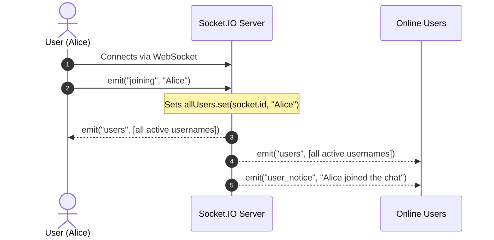
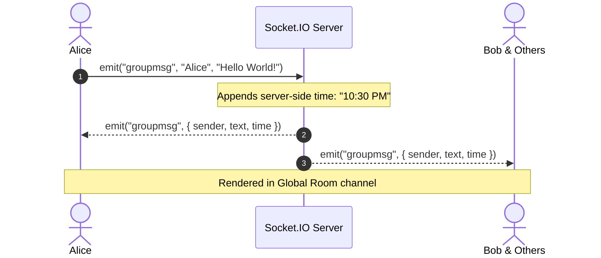
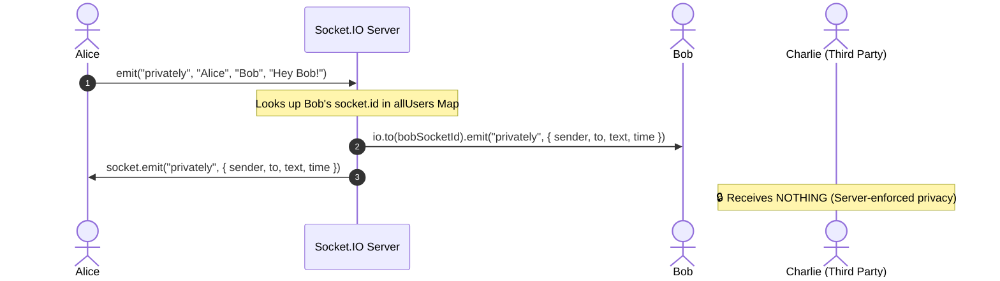
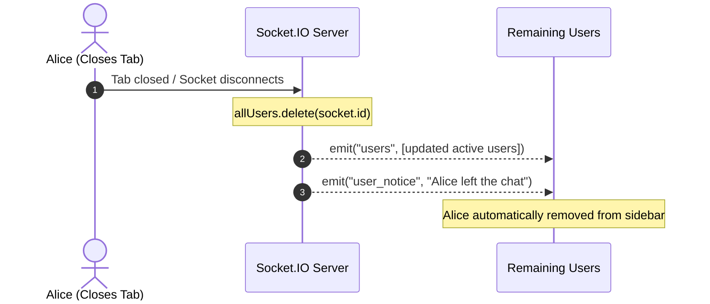

<div align="center">


### *Real-time messaging shouldn't be sluggish or leaky. Fast, secure, and lightweight WebSocket communication.*

<p align="center">
  
  
  
  
  
  
</p>

**Local Access: `http://localhost:3000`**

---

</div>

## 1. The Problem & The Idea

### The Problem
* **Polling Latency & Overhead**: Traditional HTTP-based chat applications rely on repetitive client-side polling, causing high latency, excessive server load, and sluggish user feedback.
* **Insecure Client-Side Filtering**: Many introductory WebSocket chat apps broadcast private 1-on-1 messages to *all* connected clients and filter them purely in frontend JavaScript. Anyone opening browser DevTools can intercept and read everyone's private messages.
* **Zombie / Orphaned Sessions**: Without explicit connection lifecycle tracking, users who close their tabs remain stuck in the "online users" list indefinitely.
* **Fragmented Chat UI**: Stacking separate, disconnected text boxes for group and private chats creates visual clutter and a disjointed user experience.

### The Solution
* **Full-Duplex Real-Time Communication**: Uses **Socket.IO** over WebSockets for bidirectional, low-latency, event-driven message dispatching.
* **Server-Side Targeted 1-on-1 Routing**: Maps active usernames directly to their unique `socket.id`. Direct messages are strictly transmitted to the recipient's socket (`io.to(recipientSocketId).emit(...)`) and echoed only to the sender—zero data leakage to third-party clients.
* **Live Presence Lifecycle**: Automatically cleans up offline users upon `disconnect` events and broadcasts updated rosters in real time.
* **Unified 2-Column Interface**: WhatsApp/Discord-style layout with a live online users sidebar, seamless chat switching between Global and Direct messages, auto-scroll, message timestamps, and dynamic robot avatars via DiceBear API.


## 3. Workflow & Event Lifecycle

### A. User Join & Session Registration


### B. Global Public Messaging


### C. Secure 1-on-1 Direct Messaging


### D. Disconnection & Cleanup


---

## 4. Key Highlights & Design Decisions

* ⚡ **Zero-Build Stack**: Uses CDN-delivered **Tailwind CSS** and **Phosphor Icons**. Runs instantly without complex Webpack/Vite build steps.
* 🔒 **Server-Enforced Privacy**: Private messages are routed using exact socket targets rather than broadcast channels, securing client data.
* 🤖 **Deterministic Dynamic Avatars**: Every user gets a unique, reproducible robot avatar powered by the **DiceBear Bottts API** seeded with their username.
* 💬 **Clean Tabbed Experience**: Seamless switching between the public `#Global` channel and `@Direct` user threads with separate message stores.
* ⌨️ **UX Polish**: Supports `Enter` key to send, quick emoji insertions, timestamps, and automatic scroll-to-bottom.

---

## 5. Project Structure

```plaintext
Chat_app/
│
├── views/
│   └── index.ejs          # Unified frontend (Login modal + 2-Column Chat Dashboard)
│
├── .gitignore             # Ignores node_modules
├── package.json           # Scripts, manifest, and dependencies
├── package-lock.json      # Dependency lockfile
├── README.md              # Project documentation
└── server.js              # Express app & Socket.IO event server
```

---

## 6. Setup & Installation Guide

### Prerequisites
* [Node.js](https://nodejs.org/) (v18.x or newer recommended)
* `npm` (installed automatically with Node.js)

### 1. Open Terminal in Project Directory
```bash
cd d:\Chat_app
```

### 2. Install Dependencies
```bash
npm install
```

### 3. Start the Server
```bash
npm start
```
*(Or directly with `node server.js`)*

You will see:
```plaintext
Server running at http://localhost:3000
```

### 4. Test in Browser
1. Open `http://localhost:3000` in your browser.
2. Enter a username (e.g., `Alice`) and click **Join Chat**.
3. Open a **second tab or Incognito Window** at `http://localhost:3000` with another username (e.g., `Bob`).
4. You will see both users appear in each other's sidebar under **Direct Messages**.
5. Test both the **Global Chat** and clicking on a user's name for **1-on-1 Private Messaging**.

---

## 7. Future Roadmap

Planned enhancements that naturally align with the project architecture:
- [ ] **Database Persistence**: MongoDB / SQLite integration for message history across restarts.
- [ ] **Typing Indicators**: Live `"User is typing..."` broadcast via socket events.
- [ ] **File & Media Sharing**: Image and audio attachment upload support.
- [ ] **Rooms & Channels**: Custom user-created group channels with invite links.

---

## 📄 License

This project is licensed under the [ISC License](package.json).
